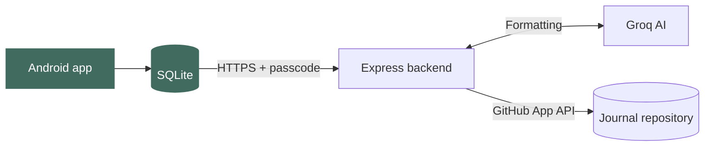

<div align="center">


[](https://github.com/realximanta/daymark/releases)
[](https://developer.android.com)
[](https://kotlinlang.org)
[](https://github.com/realximanta/daymark/actions)

[](https://github.com/realximanta/daymark/stargazers)
[](https://github.com/realximanta/daymark/releases)
[](https://github.com/realximanta/daymark/issues)
[](https://github.com/realximanta/daymark/commits/main)

**A little space for everything that makes up your day.**

Capture thoughts, organize tasks and archive your memories in Markdown.

[](https://github.com/realximanta/daymark/releases/latest)
[](https://github.com/realximanta/daymark-app)

[Features](#-features) · [Architecture](#-architecture) · [Setup](#-getting-started) · [Privacy](#-privacy--data)

</div>

## ✨ Features

| | |
| :--- | :--- |
| 📝 **Journaling** — Nine focused categories | 📶 **Offline-first** — Local SQLite storage |
| 🔄 **GitHub sync** — Markdown archives | ✨ **AI formatting** — Groq-assisted formatting |
| ✅ **Tasks & plans** — Completion tracking | 🌓 **Themes** — Light, dark and system |
| 🔔 **Reminders** — Daily notifications | 📦 **Updates** — GitHub release integration |
| 🕒 **History** — Revisit local entries | 🔑 **Authentication** — Passcode-protected sync |

## 🗂 Your day, organized

| Category | Capture |
| --- | --- |
| 🏃 Currently Doing | Activities and work |
| 🍽️ What I Ate | Meals and food notes |
| 💡 New Idea | Inspiration |
| ✅ Schedule/Tasks | Daily priorities |
| 🌧️ Regret | Lessons and reflections |
| 🏆 Success of the Day | Wins and achievements |
| 🚗 Travelled To | Places and experiences |
| 📅 Plan for Tomorrow | Tomorrow's intentions |
| 🎬 Watched | Films, shows and videos |

## ⚙ Architecture



Entries are stored locally first and uploaded as Markdown when sync succeeds.

## 🛠 Tech stack

<div align="center">


</div>

## 🚀 Getting started

Download the APK from [Releases](https://github.com/realximanta/daymark/releases). Install on Android 8.0 or newer and start journaling locally. For your own private archive, configure your own backend and rebuild the app.

<details>
<summary><b>☁️ Deploy your backend</b></summary>

1. Create a private journal repository and a GitHub App with Contents read/write access to that repository.
2. Deploy [daymark-app](https://github.com/realximanta/daymark-app) on Render or another Node.js 20+ host.
3. Configure environment variables:

| Variable | Purpose |
| --- | --- |
| `DAYMARK_PASSCODE` | Strong API secret |
| `GH_APP_ID` | GitHub App ID |
| `GH_PRIVATE_KEY` | App private key |
| `GH_INSTALL_ID` | Installation ID |
| `GH_REPO_OWNER` | Journal repository owner |
| `GH_REPO_NAME` | Journal repository name |
| `GROQ_API_KEY` | AI API secret |
| `MODEL_NAME` | Model, e.g. `openai/gpt-oss-20b` |

Verify with `curl https://your-backend-url.onrender.com/health`. Update `BACKEND_URL` in [Config.kt](app/src/main/kotlin/com/ximanta/opendiary/Config.kt), rebuild, and enter the matching passcode in Preferences → Security. Never commit credentials.

</details>

<details>
<summary><b>💻 Build from source</b></summary>

Requires JDK 17, Android SDK 34 and Gradle 8.7 or Android Studio.

```bash
git clone https://github.com/realximanta/daymark.git
cd daymark
# If the wrapper is absent:
gradle wrapper --gradle-version 8.7
chmod +x gradlew
./gradlew :app:assembleDebug
```

Output: `app/build/outputs/apk/debug/`. A Gradle-free Termux build is also documented via `build.sh`.

APK updates require matching signing keys. Uninstalling can erase local entries; preserve your data first.

</details>

<details>
<summary><b>📂 Explore the source</b></summary>

| File | Purpose |
| --- | --- |
| [MainActivity](app/src/main/kotlin/com/ximanta/opendiary/MainActivity.kt) | Dashboard and capture |
| [EntryDbHelper](app/src/main/kotlin/com/ximanta/opendiary/EntryDbHelper.kt) | Local persistence |
| [SyncService](app/src/main/kotlin/com/ximanta/opendiary/SyncService.kt) | Upload and retries |
| [PasscodeActivity](app/src/main/kotlin/com/ximanta/opendiary/PasscodeActivity.kt) | Credential setup |
| [Build workflow](.github/workflows/build.yml) | CI and releases |

</details>

## 🔐 Privacy & data

Daymark is local-first, not end-to-end encrypted. Entries are stored in SQLite and sync credentials in app-private SharedPreferences. The passcode protects uploads, not access to the diary. During sync, journal text is sent over HTTPS to the configured backend and may be processed by Groq before storage on GitHub. Use a private journal repository and a backend you trust. Sync is not a verified two-way backup or restore system.

<details>
<summary><b>❓ Troubleshooting</b></summary>

| Problem | Try this |
| --- | --- |
| HTTP 401 | Check the backend passcode |
| Pending entries | Check network and backend availability |
| APK conflict | Check signing keys before uninstalling |
| Theme not refreshed | Reopen the app |

</details>

## 🤝 Contributing

Report bugs or suggest features via [Issues](https://github.com/realximanta/daymark/issues/new). Submit changes via [Pull requests](https://github.com/realximanta/daymark/pulls). Never include private journal content or credentials. This repository is publicly viewable; an explicit software license has not yet been added.

---
<div align="center">

**Your day. Your story. Your Daymark.**

Built by [@realximanta](https://github.com/realximanta)

[](https://github.com/realximanta/daymark)


</div>
